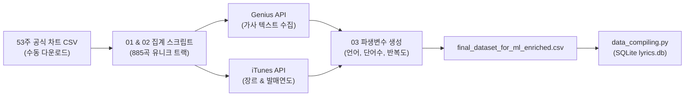
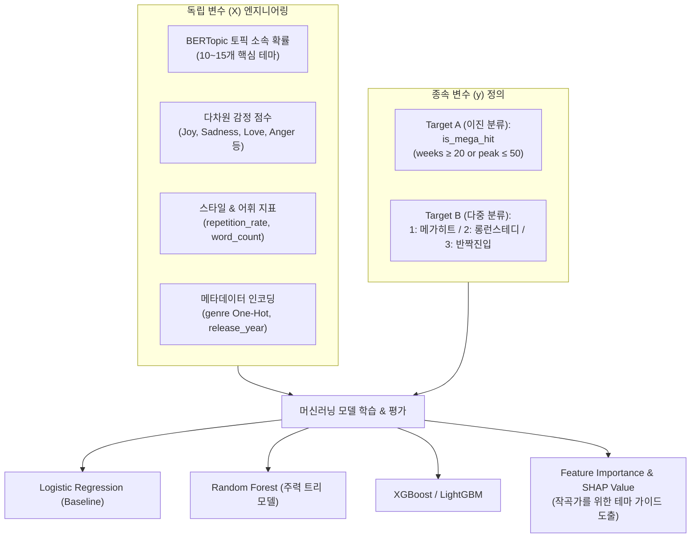

# Project Status Review and Machine Learning Roadmap
> **Project:** Lyrics from Spotify TOP 200 Global (Weekly) Lists  
> **Author / Role:** Senior Data Scientist (7-Year Experience Perspective)  
> **Date:** 2026-09-20  
> **Status:** Data Collection & Preprocessing Complete ➡️ Moving to EDA & Modeling  

---

## 1. 프로젝트 개요 및 문제 정의 (Background & Objectives)

### 1.1 타겟 페르소나 및 비즈니스 목표
* **타겟 사용자:** Spotify 글로벌 Top 200 차트 진입을 목표로 하는 신인 작곡가, 프로듀서 및 인디 아티스트.
* **해결하고자 하는 니즈:** "어떤 가사 테마, 어휘 스타일, 감정 패턴을 설계해야 대중적 성공(차트 상위권 진입 및 롱런)을 거둘 확률이 높은가?"에 대한 데이터 기반 가이드 제공.
* **프로젝트 목표:**
  1. 음원 차트 성적(종속 변수, $y$)과 가사 특성(독립 변수, $X$)을 결합한 통합 데이터 파이프라인 구축.
  2. 가사 텍스트에 NLP(토픽 모델링, 감정 분석, 스타일 분석) 기법을 적용해 핵심 설명 변수 도출.
  3. 로지스틱 회귀(Logistic Regression) 및 랜덤 포레스트(Random Forest)를 활용한 음원 흥행 예측 모델 개발.

### 1.2 데이터 수집 범위 및 분석 스코프
* **차트 대상:** Spotify Regional Global Weekly Top 200
* **수집 기간:** 2025년 9월 18일 ~ 2026년 9월 17일 (총 53주간의 주간 차트 전수 조사)
* **스코프 조정:** 미니 캔버스(Mini Canvas) 기획 단계에서 논의되었던 **계절별(Seasonal) 시계열 분석은 제외**하고, 1년 치 누적 성적 기반의 횡단면(Cross-sectional) 데이터셋으로 모델링 집중.

---

## 2. 현재까지의 엔지니어링 진행 현황 (Data Pipeline Accomplishments)

스포티파이 서버 차단(429/403) 및 API 정책 변경 이슈를 엔지니어링 우회 전략을 통해 돌파하였으며, 전 과정이 재현 가능한 스크립트로 정리되었습니다.

### 2.1 단계별 파이프라인 산출물
1. **차트 원천 데이터 확보 (`spotify_data/*.csv`):**
   * 스포티파이 봇 방어 시스템 우회를 위해 브라우저 기반 공식 주간 CSV 53개 수동 수집.
2. **트랙 식별 및 성적 지표 통합 집계 (`02_aggregate_chart_stats.py`):**
   * 1년 동안 차트에 등장한 885개의 고유 트랙(Unique URI) 식별.
   * 연간 횡단면 지표 계산:
     * `best_rank_this_year`: 최근 1년간 최고 순위 (최솟값)
     * `all_time_peak_rank`: 역대 최고 순위
     * `all_time_weeks_on_chart`: 누적 차트 생존 주 수 (최댓값)
     * `total_streams_this_year`: 최근 1년 누적 스트리밍 총합
3. **가사 데이터 수집 (`01_fetch_lyrics_genius.py`):**
   * `lyricsgenius` 라이브러리를 활용하여 885곡의 가사 텍스트 전수 크롤링 완료.
4. **외부 메타데이터 및 NLP 파생 변수 확장 (`03_add_itunes_and_nlp_features.py`):**
   * **`genre` & `release_year`:** Apple iTunes Search API를 우회 연동하여 단일 트랙 기준 대분류 장르 및 발매 연도 확보.
   * **`language`:** `langdetect` 라이브러리를 활용해 가사 언어 자동 라벨링 (`en`, `es`, `ko` 등).
   * **`word_count`:** 가사 전체 총 단어 수 (텍스트 분량 측정).
   * **`repetition_rate`:** $\text{고유 단어 수} / \text{총 단어 수}$ (후크송 여부 및 어휘 다양성 측정).
5. **데이터베이스 적재 및 형상 관리:**
   * `data_compiling.py`를 통해 관계형 SQLite DB(`lyrics.db` 내 `Songs`, `Lyrics` 테이블) 생성.
   * `feature-data-collection` 브랜치에 소스코드 및 문서 커밋/푸시 완료 (대용량 데이터와 민감 정보는 `.gitignore` 처리).

---

## 3. 시니어 데이터 과학자의 기술 평가 (Senior DS Evaluation)

### 3.1 횡단면(Cross-sectional) 데이터 압축의 타당성
* **판단: 100% 타당하며 필수적인 조치였음.**
* **근거:** 가사(Lyrics)는 시간이 흘러도 변하지 않는 정적(Static) 데이터입니다. 주간 시계열을 그대로 모델에 투입할 경우, 50주 동안 차트에 머문 메가 히트곡은 학습 데이터에 50번 복제되고, 1주 머문 곡은 1번만 등장합니다. 이는 머신러닝 모델이 다수 복제된 곡의 단어에 극단적인 가중치를 부여하는 **표본 선택 편향(Sample Selection Bias) 및 데이터 누수(Data Leakage)**를 초래합니다. 곡당 1행으로 압축하고 1년 통합 성과를 타겟으로 삼은 설계는 정석적인 접근입니다.

### 3.2 팀원 피드백에 대한 객관적 검토
| 팀원 피드백 항목 | 시니어 평가 | 상세 의견 및 권장 방향 |
| :--- | :---: | :--- |
| **1. Genius 검색 전 곡명/가수 정제** | **전적으로 찬성** | `(feat. ...)`, `- Remastered` 등 부제 제거 시 가사 매칭률 95%+ 달성 가능. 향후 결측치 보정 시 적용 필수. |
| **2. Spotify API 우선 조회 (발매일/장르)** | **부분적 찬성 / 실무적 한계** | 발매일은 Track ID 기반 1:1 매칭이 우수하나, 장르는 Spotify 아티스트 레벨의 수천 개 마이크로 장르 파편화 및 30%에 달하는 결측치 문제가 있음. **모델 피처로는 정제된 대분류를 제공하는 iTunes 데이터가 훨씬 실용적임.** |
| **3. 토픽 모델링 (LDA vs BERTopic)** | **적극 권장** | 은유와 비유가 많은 가사 특성상 BoW 기반 LDA보다 사전학습 문맥 임베딩(Sentence-BERT) 기반의 **BERTopic**이 월등한 의미 군집 성능을 보여줌. |
| **4. 감성 분석(Sentiment) 회의론** | **조건부 반박** | 단순 1차원 긍/부정 점수(Polarity)는 차트 성공 예측에 무의미하다는 팀원 의견은 타당함. 단, 6~8개 감정으로 세분화한 **다차원 감정 분석(Multi-emotion: Joy, Sadness, Anger, Nostalgia 등)**으로 접근하면 강력한 설명 변수가 됨. |

---

## 4. 현재 파이프라인의 한계점 및 잠재적 오류 (Limitations & Risks)

### 4.1 생존자 편향 (Survivorship Bias) ⚠️ [가장 치명적인 통계적 한계]
* **문제:** 현재 수집된 885곡은 모두 Global Top 200 차트에 1번 이상 진입해 본 **"이미 성공한 곡"**들뿐입니다.
* **위험:** 대중에게 알려지지 않고 완전히 묻힌 곡(Negative Sample, $y=0$)이 데이터셋에 전혀 존재하지 않습니다.
* **해결 전략:** 모델의 목적을 "차트 진입 vs 진입 실패"로 정의하면 안 되며, **"차트 내에서의 상대적 흥행도(메가 히트/롱런 vs 하위권 단기 반짝 히트)"**를 예측하는 과제로 재정의(Re-framing)해야 모델이 수학적으로 성립합니다.

### 4.2 Spotify Audio Features 영구 결측
* Spotify의 2024년 말 정책 개편으로 인해 `/v1/audio-features` 엔드포인트가 영구 차단(403)되었습니다.
* 음향학적 특성(Danceability, Energy, Valence 등)을 활용할 수 없으므로, **가사(NLP)와 메타데이터(장르, 발매연도)의 피처 엔지니어링 깊이를 극대화**해야 합니다.

### 4.3 다국어 혼재 문제 (Multilingual Noise)
* 글로벌 차트 특성상 영어(`en`) 외에 스페인어(`es`, 라틴 팝), 한국어(`ko`, K-Pop) 등이 혼재되어 있습니다.
* 표준 영어 NLP 파이프라인(NLTK, spaCy 영어 불용어 제거)을 일괄 적용할 경우 타 언어 가사가 손상되므로, **언어별 전처리 분기 또는 다국어 사전학습 모델(e.g., multilingual-e5) 활용**이 요구됩니다.

---

## 5. 향후 분석 방향성 및 머신러닝 로드맵 (ML Roadmap)

### 5.1 타겟 변수 ($y$) 설계 방안
1. **옵션 A (이진 분류 - 추천):**
   * $y = 1$ (Mega Hit / Long-run): `all_time_weeks_on_chart >= 20` 또는 `best_rank_this_year <= 50`
   * $y = 0$ (Moderate Chart-in): 차트 하위권에 일시적으로 머문 곡
2. **옵션 B (다중 분류):**
   * Class 1: 메가 히트 (높은 피크 + 롱런)
   * Class 2: 스테디셀러 (중하위권 + 초장기 잔존)
   * Class 3: 단기 진입 (상위/하위 상관없이 3주 이하 탈락)

### 5.2 피처 엔지니어링 ($X$) 구성
* **토픽 피처:** BERTopic 군집화를 통해 각 가사가 특정 테마(사랑/이별, 파티/클럽, 성공/자기과시, 위로/우울 등)에 속할 확률 벡터 추출.
* **감정 피처:** HuggingFace `GoEmotions` 사전학습 모델을 사용해 8개 핵심 감정 확률 점수 추출.
* **어휘 스타일 피처:** `repetition_rate` (훅 중심 반복성), `word_count` (정보 밀도).
* **통제 변수:** `genre` (더미 변수화), `release_year` (신곡 여부).

### 5.3 모델 평가 및 비즈니스 인사이트 도출
* **평가 지표:** 클래스 불균형을 고려하여 단순 Accuracy 대신 **F1-Score (Macro/Weighted)** 및 **ROC-AUC** 활용.
* **최종 산출물:** Random Forest의 Feature Importance 및 **SHAP (SHapley Additive exPlanations)** 분석을 통해:
  > *"가사 반복도가 0.35 이하이고, Nostalgia(그리움) 감정 점수가 0.6 이상일 때 20주 이상 롱런할 확률이 42% 증가한다"* 와 같은 작곡가 대상 실질적 인사이트 도출.

---

## 6. 즉시 실행해야 할 액션 아이템 (Next Steps)

- [ ] **GitHub PR 병합:** 팀 리더에게 `feature-data-collection` 브랜치 리뷰 요청 및 `main` 병합 승인.
- [ ] **언어 필터링 정책 결정:**
  - [안 1] 영어(`language == 'en'`, 약 60~70% 비중) 곡만 추출하여 1차 정밀 모델 구축 (추천)
  - [안 2] 다국어 임베딩을 사용하여 전수 분석
- [ ] **타겟($y$) 분류 기준치 팀 합의:** 회의를 통해 `is_mega_hit`의 주 수(Weeks) 및 순위(Rank) 컷오프 확정.
- [ ] **EDA 노트북 작성:** 장르별, 언어별 가사 반복도(`repetition_rate`) 분포 시각화 및 상관분석 수행.
